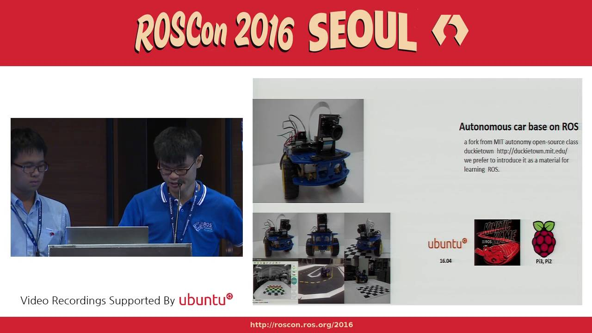

## Overview

<iframe src="https://www.youtube.com/embed/P3fH8zuRZhs" width="100%" height="500px" title="Puyuma self-driving system: Lane visualization" frameborder="0" allow="accelerometer; autoplay; clipboard-write; encrypted-media; gyroscope; picture-in-picture; web-share" referrerpolicy="strict-origin-when-cross-origin" allowfullscreen></iframe>

<iframe src="https://www.youtube.com/embed/84MXc0_F61o" width="100%" height="500px" title="Puyuma self-driving system - lane following control" frameborder="0" allow="accelerometer; autoplay; clipboard-write; encrypted-media; gyroscope; picture-in-picture; web-share" referrerpolicy="strict-origin-when-cross-origin" allowfullscreen></iframe>

## Publication

S.-W. Wang, S.-W. Cheng, and C.-C. Huang, "[Puyuma: Linux-based RTOS Experimental Platform for Constructing Self-Driving Miniature Vehicles](https://link.springer.com/chapter/10.1007/978-3-030-01174-1_75)," Science and Information Conference (SAI), London, United Kingdom, 2018.

## ROSCon 2016 Seoul Lightning Talk

